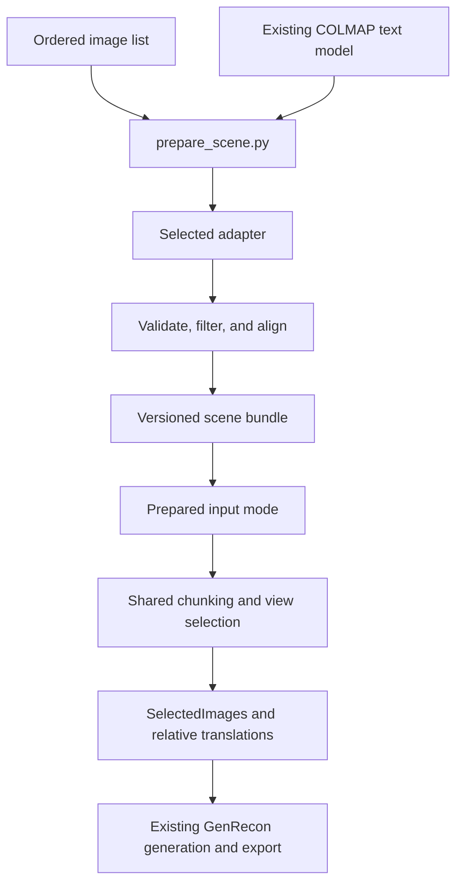

# Configurable feedforward localization implementation plan

Implement a selectable camera-and-geometry preparation stage for GenRecon, with MapAnything, VGGT-Omega, and DA3 adapters. A versioned scene bundle is the boundary between preparation and generation. Keep the existing generative model inputs and checkpoints, and retain the current dataset modes as compatibility paths.

Status: milestones 1–3 are implemented on `feat/ff-loc`. The Prepared bridge and MapAnything adapter have completed GPU generation and GLB export on one 16-frame indoor capture, including a second generation seed reusing the immutable bundle. Legacy/prepared tensor equivalence remains CPU-fixture evidence; the optional COLMAP Open3D cleaning path is not included in this GPU qualification. See [Milestone 3 evidence](validation/mapanything-m3.md) for timings, visual review, failures and limitations. VGGT-Omega and DA3 remain planned. The original plan was committed as `ac16bb7`, against source at `719cfb3`.

**Implementation strategy**

Start with two commands: prepare a scene, then reconstruct from that prepared scene. This gives us reusable frontend results, separate dependency environments when needed, and a process boundary that releases frontend GPU allocations before GenRecon starts. Backend selection belongs to preparation; reconstruction only needs to understand one new `Prepared` input mode.

Use a small fixed registry with lazy imports and one adapter per backend. Use ordinary dataclasses, NumPy arrays, and JSON configuration. Add configuration fields when a supported backend needs them. A plugin discovery framework, service, and automatic backend fallback are outside the first release.



The first release accepts an image directory or explicit ordered frame manifest. Video decoding can remain a separate preparation step. Frontend frame selection is deterministic and happens before model inference; GenRecon's existing `--num_imgs_per_scene` remains a separate conditioning budget. Every conditioning frame must have a corresponding estimated camera.

**Scene bundle contract**

The bundle represents one static scene with pinhole cameras in a shared coordinate frame. It contains:

| Field | Contract |
| --- | --- |
| Frames | Stable IDs, capture order, source paths, conditioning image paths, and actual image width/height. Paths within the bundle are relative. |
| Intrinsics | Float32 `[N, 3, 3]` matrices in pixels, matching each stored conditioning image exactly. Normalize only at the existing selector boundary. |
| Camera poses | Float32 `[N, 4, 4]` camera-to-world matrices, using OpenCV camera axes: x right, y down, z forward. Rotations remain rigid. |
| Scene points | Finite float32 `[P, 3]` points in the same world as the cameras. These establish bounds and chunk coverage. |
| Coordinate metadata | An explicit z-up scene frame, the source-to-scene transform and inverse, and a scale status such as arbitrary, predicted metric, or externally calibrated. |
| Image provenance | Source and processed image dimensions plus exact crop/resize/padding transforms when available. Identify whether conditioning uses processed images or source-resolution images. |
| Run provenance | Backend, model/checkpoint identity, source revision, resolved options, selected frames, source fingerprints, package versions, device, and stage timings. |
| Optional diagnostics | Point colors and references to depth, confidence, or mask files. Confidence semantics remain backend-specific. |

Store metadata in `scene.json`, arrays in `geometry.npz`, and conditioning images under `images/`. Optional dense diagnostics belong under `diagnostics/`; they are not required to reconstruct. Read arrays without pickle. Validate schema version, array shapes, image dimensions, unique IDs, finite values, positive focal lengths, invertible intrinsics, and rigid camera rotations. Adapter results begin with an explicit unaligned status; only geometry that has completed alignment may be written as a reconstruction-ready bundle.

The initial adapter path may store the model's processed images with their matching intrinsics. This is a useful integration milestone, but upscaling those images cannot recover original detail. Before comparing final mesh quality, implement and verify mapping calibration back to equivalent source-resolution conditioning images where preprocessing is invertible. Record any remaining crop or resolution differences. Distortion rectification requires the actual rectified image and calibration; it cannot be represented by a crop/resize affine alone.

Bundle writes use a temporary sibling directory and publish only after validation. An existing output is reused only when its manifest and contents match the requested inputs, checkpoint, adapter version, and options. A mismatch produces a clear error and asks for a new output directory or an explicit replacement option. A failed preparation must never leave a bundle that reconstruction treats as complete.

**Geometry policies**

- Require a supplied up vector in the frontend's output world, or an explicit `--assume_z_up`. Derive a proper rotation to +Z and apply it to cameras and points together. Automatic camera-up or plane estimation is a later opt-in feature; do not silently equate the first camera's axes with gravity.
- Preserve backend scale by default. An optional positive scale factor scales points and camera centers together, while keeping camera rotations orthonormal. Scale status must survive into output metadata; an arbitrary-scale reconstruction must not be labeled meters.
- Remove nonfinite and invalid geometry, then apply backend-specific depth/confidence masks. Use deterministic sampling and voxel deduplication to bound point count. Choose voxel/filter distances relative to a robust scene extent when metric scale is unavailable. Do not feed neural confidence values into COLMAP reprojection-error fields.
- Record the cleaning policy and point counts at each stage. Point density influences both percentile bounds and chunk retention. The Prepared path needs an explicit minimum occupied-voxel/point policy after downsampling, rather than silently inheriting the existing default of 500 raw points.
- Validate nonempty points, nondegenerate scene extent, at least two usable cameras for the initial multiview workflow, and a nonempty chunk/view result. Bound the number of chunks before allocating a large grid. Failed validation should name the offending stage and input.
- Export generation artifacts in the aligned scene frame. Save the source-to-scene transform and inverse with the reconstruction. The current GLB preparation reads a scalar chunk size and axis-aligned origin in [`reconstruct_scene.py`](../reconstruct_scene.py#L450); inserting a rotated transform there would make the voxel volume inconsistent. A future source-frame export must transform the finished asset and its normals/node transforms after baking, as appropriate.

**Proposed code layout**

| File | Responsibility |
| --- | --- |
| `prepare_scene.py` | Parse preparation arguments, select frames, invoke one backend, validate and write the bundle. No GenRecon pipeline import. |
| `inference/scene_geometry.py` | Scene dataclasses, bundle reading/writing, schema validation, and provenance. |
| `inference/geometry.py` | Shared pose conversion, depth unprojection, image-coordinate transforms, world alignment, and bounded point processing. |
| `inference/frontends/__init__.py` | Fixed registry of backend names to lazy loaders. |
| `inference/frontends/colmap.py` | Import existing COLMAP text cameras and points with an explicit image root. |
| `inference/frontends/mapanything.py` | MapAnything loading, inference, and output adaptation. |
| `inference/frontends/vggt_omega.py` | VGGT-Omega loading, camera decoding, and output adaptation. |
| `inference/frontends/da3.py` | DA3 loading, model-capability validation, and output adaptation. |
| `inference/get_images.py` | A camera-list entry point shared by legacy loaders and Prepared input. |
| `inference/get_chunks.py` | A point-array entry point and Prepared policy, reusing grid placement and transforms. |
| `reconstruct_scene.py` | Prepared input dispatch, preflight validation, delayed generation imports/loading, and bundle provenance in outputs. |
| `configs/frontends/*.json` | Small reproducible presets for each backend/checkpoint family. |
| `tests/test_scene_geometry.py`, `tests/test_prepared_scene.py` | Analytic geometry, bundle failures, and legacy/prepared bridge equivalence. Add adapter tests as backends land. |

Keep geometry preparation independent of CUDA extensions. Core contract tests run with NumPy and image dependencies; bridge tests can use CPU PyTorch. Generation qualification still requires GenRecon's supported GPU environment.

**Milestone 1 — Define and verify the shared geometry contract**

Dependencies: none. This milestone provides a useful standalone scene validator and portable bundle format.

- [x] Add the dataclasses, schema version, JSON/NPZ serialization, and validation in `inference/scene_geometry.py`.
- [x] Define the adapter callable as `infer(frames, config) -> SceneGeometry` before shared world alignment. Use a fixed registry and keep model imports inside the selected adapter.
- [x] Implement OpenCV camera-to-world/world-to-camera conversion, homogeneous matrix handling, z-depth unprojection, and pixel-to-normalized intrinsics conversion.
- [x] Implement crop/resize/padding transforms with documented pixel-center conventions. Record the exact upstream operation order and rounding; EXIF rotation must be handled consistently with actual decoded pixels.
- [x] Implement up-vector rotation, optional scale transformation, and deterministic bounded point processing. Validate source and aligned geometry separately.
- [x] Add independent analytic fixtures: known cameras and a plane, noncentral principal points, rectangular images, and a nontrivial rotated/scaled world. Verify reprojection invariance, image-transform consistency, and depth unprojection against known coordinates.
- [x] Test malformed matrices, image/array count mismatches, empty clouds, NaNs, incomplete bundles, and incompatible cache fingerprints.

Done when: a synthetic bundle round-trips without changing geometry, known 3D points project to expected pixels before and after each transform, and invalid bundles fail before generation-model loading. No frontend checkpoint is needed for this gate.

**Milestone 2 — Connect the bundle to the existing pipeline**

Dependencies: milestone 1. This milestone lets existing calibrated scenes use the new interface and isolates adapter errors from integration errors.

- [x] Extract `get_images_from_cameras(...)` from `BaseImageSelecter.get_images(...)`; leave legacy parsing and selection semantics intact. Convert canonical poses to the current `c2w_blender` dictionaries only at this bridge.
- [x] Extract chunk construction from point arrays after cleaning. Keep existing legacy filters and thresholds available; give Prepared input an explicit cleaning/density policy so a bundle is not accidentally filtered twice.
- [x] Add the COLMAP text importer with explicit image paths, stable frame order, supported pinhole/undistortion handling, and a compatibility path for legacy point filtering.
- [x] Add `--mode Prepared --path <bundle>` to reconstruction. Load and validate the bundle once, then supply it to both the chunker and selector. Keep backend selection independent of dataset mode.
- [x] Add a preparation/preflight path that writes selected views, camera/point diagnostics, chunk counts, and transforms without loading generator weights. Move generation-only imports and model loading after preflight; define and reseed selection/model RNGs so loading order cannot change picks.
- [x] Resolve the current `--skip_point_cleaning` dispatch mismatch: the CLI forwards this keyword, but `IphoneChunker` does not currently accept it. Limit the fix to supported mode behavior and give incompatible options clear errors.
- [x] Compare legacy and Prepared camera matrices, crop-adjusted intrinsics, selected frame IDs, chunk transforms, and relative translations under the same settings and seed. Ensure the comparison uses identical points and cleaning policies.
- [x] Keep aligned-frame metadata consistent across mesh PLY, voxel coordinates, `to_glb_inputs.pt`, and `chunk_inputs.pt`.

Done when: a small calibrated fixture produces matching prepared tensors and chunk layouts through both routes, and Prepared preflight works without neural frontend packages or generation checkpoints. A supported-GPU smoke run of the same scene must also complete before the bridge is labeled end-to-end qualified.

**Milestone 3 — Make MapAnything work end to end**

Dependencies: milestones 1 and 2. This is the first usable feedforward reconstruction milestone.

- [x] Add `prepare_scene.py` frame discovery/ordered-manifest input, deterministic frame cap, backend/config selection, explicit orientation options, and bundle output.
- [x] Add the MapAnything adapter using the official inference API. Capture pinhole intrinsics, OpenCV camera-to-world poses, world points, validity masks, and image preprocessing metadata.
- [x] Support an explicit local checkpoint or pinned model revision; write the resolved identity into the bundle. Provide actionable missing-dependency/checkpoint errors.
- [x] Start with processed images paired with their own intrinsics. Add tested source-resolution calibration mapping before interpreting differences in final mesh detail as a frontend-quality effect.
- [x] Add a conservative preset with bounded frame count and point count. Keep confidence/masking options specific to this backend and save their resolved values.
- [x] Record synchronized inference wall time, complete preparation wall time, peak allocated/reserved GPU memory, host-memory observations where available, point retention, and failure status. Separate model download/cache state from steady inference timing.
- [x] Run a small indoor capture through preparation, preflight, generation, and GLB export. Review camera layout, upright orientation, selected images, bounds, and exported mesh alignment.

Done when: a real image set produces a valid reusable scene bundle and a visually inspected GenRecon asset. Re-running generation with different seeds/settings must reuse the bundle without importing or rerunning MapAnything. Report checkpoint, input count/resolution, hardware, and any manual orientation/scale input.

**Milestone 4 — Add VGGT Omega and DA3 through the same interface**

Dependencies: the shared path proven by milestone 3. Each adapter can be completed and qualified independently.

- [ ] Add VGGT-Omega with explicit checkpoint and preprocessing resolution. Decode its camera representation with the official utility, extend world-to-camera `[3, 4]` matrices to homogeneous form, invert to the canonical convention, and unproject depth using matching intrinsics.
- [ ] Add DA3 using its official API. Validate that the selected model returns cameras; provide Base and Small presets from the main camera-capable series. Reject incompatible depth-only variants with a clear explanation.
- [ ] For both adapters, preserve frame order/reference-view handling, distinguish z-depth from ray distance, and test batch dimensions and output image sizes against actual upstream outputs.
- [ ] Add small recorded outputs or synthetic boundary fixtures for convention conversion and image calibration, plus an opt-in real-checkpoint smoke test for each adapter. Fixture tests do not substitute for real inference.
- [ ] Verify each adapter's crop/resize/padding mapping and optional source-resolution conditioning route. A shared scalar resize assumption is insufficient.
- [ ] Document per-backend installation in separate environments initially. Record tested upstream revisions and dependency constraints rather than installing all research repositories into GenRecon's environment.
- [ ] Run the same bounded capture through VGGT-Omega, DA3-Base, and DA3-Small, inspect diagnostics, and verify all bundles use the same schema and generation command.

Done when: changing only frontend/config/output arguments produces independently validated bundles for all three backend families, and every supported preset passes an end-to-end smoke run. Until then, mark each adapter as implemented, inference-validated, or end-to-end qualified according to its actual evidence.

**Milestone 5 — Qualify the comparison and document normal use**

Dependencies: milestones 2 through 4. This milestone distinguishes successful integration from an improvement in reconstruction quality or cost.

- [ ] Select a small named pilot set: one ordinary indoor capture, one with sparse overlap or weak texture, and one with motion/blur. Include a calibrated/reference scene where practical. Record every failed run.
- [ ] Save explicit source-frame manifests, generator checkpoints, seeds, sampling settings, conditioning image/crop policy, scale/alignment policy, and compute limits. Report any backend-specific image preprocessing differences.
- [ ] Run two comparisons where reference data permits: fixed reference chunks to isolate camera conditioning, and each frontend's own point-derived chunks to measure the complete system. Keep fixed reference bounds out of the claimed arbitrary-video workflow.
- [ ] For reference measurements, define one scene-level rigid/similarity alignment protocol before scoring. Report scale ambiguity and avoid per-chunk alignment that could hide drift.
- [ ] Report preparation time, generation/export time, total wall time, GPU peak memory, chunk count, retained frames/points, and usable-output rate. Distinguish cold-start costs and cache reuse.
- [ ] Inspect meshes for observation alignment, completeness, duplicated surfaces, and implausible scene bounds. Add surface metrics only where reference geometry supports them. A plausible mesh or successful API return alone is not a quality pass.
- [ ] Estimate pilot runtime after the first smoke scene; choose a bounded pilot budget before running it. Broader benchmarking is a separate scope decision.
- [ ] Add README usage, configuration meanings, dependency recipes, orientation examples, cache behavior, output coordinate conventions, and the qualification table.

Done when: all supported frontends have reproducible usage and qualification records, legacy/prepared compatibility is retained, and the pilot supports a clearly scoped default recommendation or an explicit statement that no quality winner has been established.

**Proposed command surface**

The Prepared reconstruction mode and MapAnything preparation command below are implemented; `prepare_scene.py` supports COLMAP text import and MapAnything. See [Prepared scenes](prepared-scenes.md) for working commands. `--assume_z_up` is appropriate only when the supplied reconstruction frame is known to be upright. Ordinary unaligned neural output instead requires `--up_vector X Y Z`, expressed in that backend's world frame. Replace the three component placeholders with the known or manually determined up direction; this explicit orientation step is an initial usability limitation, addressed by later automatic estimation.

```sh
python prepare_scene.py \
  --images capture/rgb \
  --frontend mapanything \
  --config configs/frontends/mapanything.json \
  --up_vector X Y Z \
  --output prepared/capture-mapanything

python reconstruct_scene.py \
  --mode Prepared \
  --path prepared/capture-mapanything \
  --output_path results/capture-mapanything \
  --ss_ckpt "$SS_CKPT" \
  --shape_ckpt "$SHAPE_CKPT" \
  --tex_ckpt "$TEX_CKPT"
```

Use `--frontend vggt_omega` or `--frontend da3` with the corresponding config to switch estimators. Each preset separates checkpoint identity, inference resolution/precision, maximum frames, and point-filtering settings. Common overrides are limited to options that have the same meaning across adapters; backend-specific options remain validated config fields.

**Decisions that keep the first release small**

Use thin direct adapters to the official projects. MapAnything's framework already includes external-model wrappers, but its [dependency configuration](https://github.com/facebookresearch/map-anything/blob/main/pyproject.toml) currently points its DA3 extra at a separate fork. Taking that entire framework as GenRecon's provider layer would introduce additional dependency and behavior choices. Its wrappers remain useful references.

Separate environments are practical because GenRecon's [setup](../setup.sh#L69) pins PyTorch, while [DA3 declares xformers and other substantial dependencies](https://github.com/ByteDance-Seed/Depth-Anything-3/blob/main/pyproject.toml), and [VGGT-Omega has its own package constraints](https://github.com/facebookresearch/vggt-omega/blob/main/pyproject.toml). Shared-environment compatibility is something to test later, not a prerequisite for the bundle interface.

Keep depth/confidence as adapter diagnostics and filtering inputs initially. Feeding uncertainty or depth directly into the learned conditioner is a separate model change. Long-video submaps/SLAM, bundle adjustment, automatic fallback between models, automatic gravity estimation, fisheye/360 input, streaming scene updates, and a one-command subprocess launcher can follow once the bounded image-set workflow is qualified.

Reference interfaces: [MapAnything outputs](https://github.com/facebookresearch/map-anything#image-only-inference), [VGGT-Omega camera decoding](https://github.com/facebookresearch/vggt-omega/blob/main/vggt_omega/utils/pose_enc.py), and [DA3 API](https://github.com/ByteDance-Seed/Depth-Anything-3/blob/main/docs/API.md). Recheck these at the pinned revisions when implementing each adapter.
