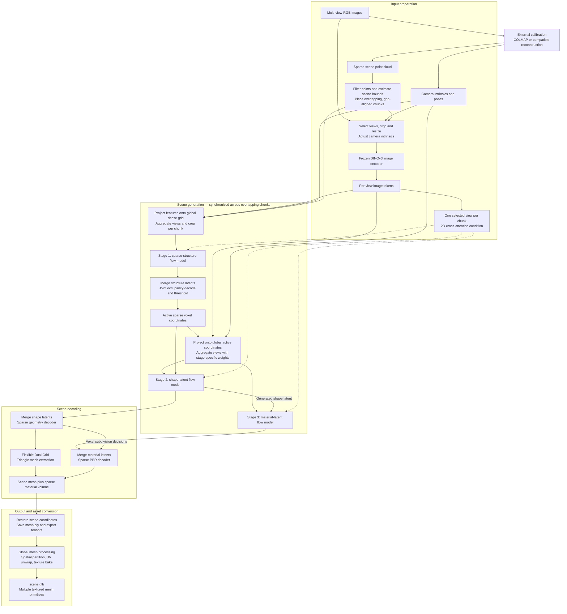
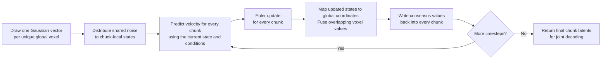

# GenRecon: Theory of Operation

**GenRecon turns multi-view reconstruction into conditional 3D generation.** It adapts TRELLIS.2’s learned shape prior to generate overlapping pieces of a scene, while camera-aligned image features and repeated agreement between neighboring pieces keep the reconstruction spatially coherent.

This overview traces the inference, conditioning, sampling, training, decoding, and export paths at commit `eaf1468`, cross-checked against the [paper’s method description](https://arxiv.org/html/2605.23888v1). It is a source-level analysis, not a report of measured runtime or reconstruction quality. The dimensions and defaults below describe the supplied configurations; a checkpoint’s training configuration can change them.

The complete system is:

The central implementation is [`FullSceneImagesTo3DPipeline.run()`](../genrecon/pipelines/full_scene_images_to_3d.py#L399). Each generative stage in the diagram uses the same synchronized sampling mechanism described below.

**The input cameras establish the coordinate system.** The reconstruction CLI expects calibrated images; it does not run COLMAP itself. In the COLMAP modes, sparse points primarily determine scene bounds and chunk placement. They are not passed into the generative models as a point-cloud conditioning signal. Ground-truth modes instead obtain the scene extent from room metadata or an aligned mesh.

The chunker estimates the room’s extent, chooses a cube size based on its height, and tiles the horizontal floor plan. Every cube maps into `[-0.5, 0.5]³`. Chunk centers are separated by multiples of one-sixteenth of the cube width, with at least 25% overlap by default. That alignment makes a physical location land on corresponding integer lattice coordinates across chunks at the model’s resolutions.

This is an architectural requirement: overlap fusion uses coordinate equality and integer offsets, so it depends on all chunks sharing compatible scale, orientation, and grid alignment. The normal chunker uses one vertical layer of cubes spanning the room height. See [`BaseChunker`](../inference/get_chunks.py#L15).

Image preparation produces two conditioning inputs:

- A scene-wide collection of views, used to build the spatial 3D condition.
- One selected view per chunk, used by the inherited 2D cross-attention pathway.

The selector samples views along the camera list, prefers a visible view for each chunk, and falls back to the closest camera when necessary. Cropping updates the intrinsics so projection remains consistent. The iPhone path can turn a rectangular frame into two square views. See [`get_images()`](../inference/get_images.py#L210).

**The main adaptation is to attach image evidence to explicit 3D locations.** DINOv3 independently encodes each image. With the supplied 512-pixel configuration, a view supplies a `32 × 32` patch grid of 1,024-dimensional features, plus five leading global tokens.

For a candidate voxel center $x$, the projection code:

1. Transforms $x$ into each camera’s coordinates.
2. Projects it with the camera intrinsics.
3. Checks positive depth and whether the projection lies inside the image.
4. Retrieves the DINO feature for the containing image patch.

In simplified notation, with $T_i$ mapping the shared scene frame into camera $i$ and $\pi$ performing perspective division,

$$
f_i(x)=F_i\!\left(\pi(K_iT_i[x,1]^\top)\right).
$$

The implementation uses discrete patch lookup. It does not infer depth at this point or perform an occlusion test. Several candidate points along a camera ray can therefore retrieve the same patch feature. Multiple views and the learned generative model must resolve the ambiguity. See [`project_features_on_points()`](../genrecon/modules/cond_3D/projection.py#L163).

The view aggregator computes a masked mean $\mu$ and variance $\sigma^2$ at each voxel. Two shared MLPs use each view’s feature together with those statistics to produce a residual feature and a weighting logit:

$$
G(x)=\mu(x)+
\sum_i
\operatorname{softmax}_i\!\left(
\mathrm{MLP}_{w}[f_i,\mu,\sigma^2]
\right)
\mathrm{MLP}_{f}[f_i,\mu,\sigma^2].
$$

The sum and softmax operate over valid views. This gives the network a learned way to reconcile conflicting observations. Its symmetric reductions make the **3D aggregation pathway invariant to view ordering**, apart from numerical effects. If no view projects validly onto a voxel, that voxel’s aggregated condition is zero.

The final feature MLP starts at zero, so the aggregator initially behaves as a simple mean. See [`MultiViewFeatAggregator`](../genrecon/modules/cond_3D/aggregation_net.py#L85).

For full-scene inference, aggregation happens on a shared global lattice before conditions are distributed to chunks. Consequently, two chunks describing the same voxel receive the same 3D evidence. The structure stage uses a dense grid; shape and material stages use the deduplicated union of active sparse coordinates. Each stage has its own learned aggregator.

**The model then generates structure, geometry, and materials in sequence.** These representations have different jobs:

| Stage | Representation in the supplied 512 configuration | What it determines |
|---|---|---|
| Sparse structure | Dense `16³ × 8` latent; decoded occupancy is pooled to a `32³` grid | Which coarse spatial cells should carry detailed surface information |
| Shape SLat | 32 learned values per active cell on the `32³` lattice | Detailed geometry that the shape decoder expands to a nominal 512-resolution lattice |
| Material SLat | 32 learned values per active cell, conditioned on the 32-channel shape latent | Base color, metallic, roughness, and opacity |
| Decoded scene | Triangle mesh plus six material channels on sparse fine voxels | Geometry and appearance ready for rendering or texture baking |

“SLat” means *structured latent*: a learned feature vector associated with an explicit sparse 3D coordinate. Resolution here is per chunk; it does not imply a single `512³` dense allocation for the entire scene or a measured geometric accuracy.

The structure stage thus allocates spatial support before the expensive detailed stages run. Shape and material sampling keep those coarse coordinates fixed and evolve their feature values. The geometry decoder later predicts finer subdivisions.

The material model receives the generated shape latent concatenated with its noisy material latent: 64 input channels produce a 32-channel material velocity prediction. Geometry therefore directly conditions appearance. The supplied dimensions are defined in the [structure](../configs/gen/ss_flow_img/genrecon.json), [shape](../configs/gen/slat_flow_img2shape/genrecon_512.json), and [material](../configs/gen/slat_flow_imgshape2tex/genrecon_512.json) configurations.

Each flow model uses 30 transformer blocks with width 1,536 and 12 attention heads. Within a block:

- The spatial 3D condition passes through a learned linear layer and is added to the corresponding latent tokens.
- Self-attention exchanges information between tokens within the chunk.
- Cross-attention reads the selected image’s tokens.
- Timestep-conditioned normalization and gates control the update.

The new 3D injection layers are zero-initialized, allowing adaptation to begin from the pretrained model’s behavior. The dense and sparse implementations are in [`SparseStructureFlowModel`](../genrecon/models/sparse_structure_flow.py#L233) and [`SLatFlowModel`](../genrecon/models/structured_latent_flow.py#L177).

**Generation is numerical integration of a learned velocity field.** During training, a ground-truth latent $z_0$ is mixed with Gaussian noise $\epsilon$:

$$
z_t=(1-t)z_0+
\left[\sigma_{\min}+(1-\sigma_{\min})t\right]\epsilon.
$$

The network learns the velocity

$$
v^*=(1-\sigma_{\min})\epsilon-z_0
$$

using mean-squared error. At inference, it starts from Gaussian noise at $t=1$, then integrates backward toward $t=0$:

$$
z_{t'}=z_t-(t-t')v_\theta(z_t,t,\text{conditions}).
$$

These equations are implemented in the [flow-matching trainer](../genrecon/trainers/flow_matching/flow_matching.py#L71) and [Euler sampler](../genrecon/pipelines/samplers/flow_euler.py#L66). The supplied minimum noise scale is $\sigma_{\min}=10^{-5}$.

The supplied pipeline configuration uses 12 integration steps per stage. Classifier-free guidance combines conditioned and zero-image-conditioned predictions during selected timestep intervals. Structure and shape use guidance strength 7.5; material guidance is 1.0 in [`original.json`](../configs/pipelines/original.json) and 5.0 in [`texture.json`](../configs/pipelines/texture.json). These are configuration defaults, not measured optimal settings. The material model retains its shape-latent input even when its image conditions are zeroed.

**Overlapping chunks agree throughout that integration.** This is the second major mechanism that lifts an object-sized model to scene scale:

Three details matter:

- **Shared initial noise:** overlapping voxels receive the same random vector. Averaging independent initial noise would reduce its variance and change the starting distribution.
- **Repeated consensus:** after every Euler step, overlapping latent values are averaged and redistributed. A boundary disagreement is corrected while generation is still evolving.
- **Boundary-sensitive fusion:** by default, shape and material predictions near a chunk’s horizontal edges do not contribute to the average, but still receive interior neighbors’ values. If no interior contributor exists, the original prediction is retained.

The current implementation evaluates chunks sequentially within each timestep, then synchronizes them. “Joint generation” describes their coupled states, not simultaneous execution on separate GPUs. See [`MultiDiffusionOrchestrator`](../genrecon/pipelines/samplers/multi_diff_orchestrator.py#L247).

This creates three layers of consistency: **shared image evidence, shared sampling states, and shared decoding context**.

**Joint decoding converts the latent scene into explicit surfaces.** In the default 512 path, chunk latents are shifted into a common lattice, overlapping entries are deduplicated and averaged, and the geometry decoder runs on the merged sparse scene.

Its fine-grid output contains:

| Geometry output | Purpose |
|---|---|
| Three position values | Locate a dual vertex relative to its voxel |
| Three intersection logits | Indicate surface intersections along grid-edge directions |
| One positive split weight | Help choose how surface quads become triangles |

O-Voxel’s Flexible Dual Grid conversion connects neighboring dual vertices around intersected edges and triangulates the resulting quads. This is the explicit surface representation beneath the generated mesh. See [`joint_decode_shape()`](../genrecon/pipelines/joint_decode.py#L243) and [`flexible_dual_grid_to_mesh()`](../o-voxel/o_voxel/convert/flexible_dual_grid.py#L150).

The material decoder reuses the shape decoder’s subdivision decisions. That keeps fine material voxels aligned with the generated geometry. Its six channels are RGB base color, metallic, roughness, and alpha. The pipeline returns a `MeshWithVoxel`, which holds both the triangle surface and this sparse attribute volume.

The separate GLB conversion performs global mesh processing, partitions faces by their nearest chunk center, and UV-unwraps and bakes each partition. It samples the **generated material volume** into texture maps. The resulting `scene.glb` can contain multiple mesh primitives and materials. See [`chunked_to_glb()`](../inference/chunked_glb.py#L310).

**Training teaches the pretrained generator to obey this spatial conditioning.** The supplied data pipeline builds synthetic rooms, renders posed views, extracts normalized chunks, converts their surfaces and materials into O-Voxel representations, and encodes training latents with pretrained encoders.

The three generative stages are trained separately against those latents. The supplied configurations sample between one and sixteen conditioning views per training example.

Adaptation is deliberately limited:

- Original flow-model parameters are frozen.
- Rank-8 LoRA adapters train the self-attention and cross-attention projections.
- New view aggregators and per-block 3D injection layers train normally.
- DINO feature extraction runs without gradients.
- Image conditions are dropped with probability 0.1 to train classifier-free guidance.

The construction order is significant: the existing model is frozen and receives LoRA first; the new projection modules are added afterward, leaving them trainable. See the [data preparation workflow](../data_toolkit_scenes/README.md), [model builder](../genrecon/utils/model_wrapper_utils.py#L6), and [LoRA implementation](../genrecon/modules/lora.py#L38).

This explains the role of the generative prior: observations constrain the latent scene, while pretrained knowledge supplies plausible structure where observations are incomplete. The inference path performs sampling and decoding; it does not optimize network weights separately for each captured scene.

**Several implementation boundaries affect how to interpret or deploy it:**

| Boundary | Consequence |
|---|---|
| Projection is geometrically aligned, but reconstruction remains learned | Correct projection does not guarantee an exactly photo-consistent surface. Unobserved geometry is a plausible completion. |
| View aggregation is symmetric, but CLI view selection depends on camera-list order | Permutation invariance applies to the aggregation operation; arbitrary input reordering need not preserve the complete CLI result. |
| Structure determines downstream sparse support | Missing support can suppress later detail. Lowering the occupancy threshold increases coverage and computational cost. The CLI defaults to raw logit threshold `-1.0`. |
| Sparse tokens still use full attention within each chunk | “Sparse” means empty spatial cells are omitted. Attention arithmetic still grows approximately quadratically with the active token count. |
| Global conditioning and decoding retain scene-sized data | Chunking bounds transformer context, but does not make total memory independent of scene extent. |
| The public CLI permits only `--pipeline 512` | The full-scene class accepts 1024 with suitable models; inherited cascade options are not accepted by that class. |
| CUDA is embedded throughout the implementation | Explicit `.cuda()` calls, sparse kernels, CuMesh, and rasterization prevent the CLI’s apparent CPU fallback from providing a working end-to-end CPU or Apple GPU path. |
| Checkpoint loading depends on training configuration files | The loader expects `config.json` in the checkpoint’s parent run directory; a standalone `.pt` file is insufficient for this loading path. |

The memory controls reflect these costs. Projection processes voxel batches—8,192 by default—to limit the temporary view-by-voxel feature tensor. `low_vram=True` moves models between CPU and GPU between stages. The 1024 path also groups large joint decodes spatially, with overlap around groups to provide neighboring context; the 512 path retains a single merged decode. These are implementation mechanisms, not guarantees of a particular VRAM requirement. See [projection batching](../genrecon/pipelines/full_scene_images_to_3d.py#L38), [decode limits](../genrecon/pipelines/full_scene_images_to_3d.py#L605), and [checkpoint configuration lookup](../genrecon/pipelines/setup_utils.py#L322).
