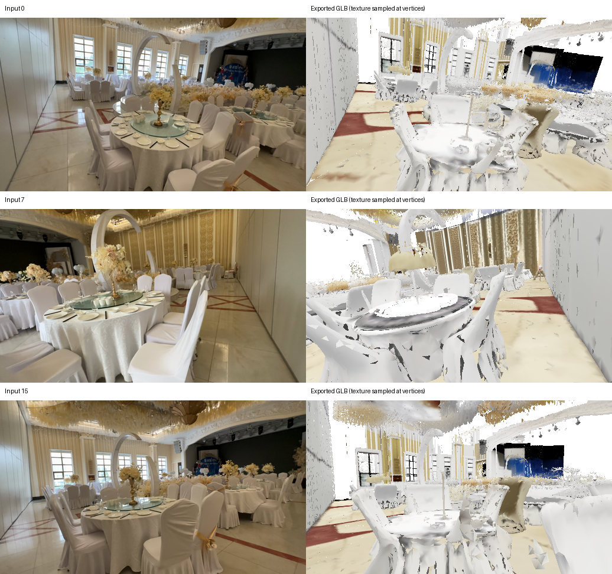

# MapAnything milestone 3 qualification

Milestone 3 passed one indoor integration smoke test on 2026-10-29, including GLB visual inspection and bundle reuse for a second generation seed. This is not a frontend-quality comparison.

## Inputs and runtime

- Host: `mel06293d`, NVIDIA RTX 4090 (24 GiB).
- Capture: DL3DV banquet room `0853979305f7ecb80bd8fc2c8df916410d471ef04ed5f1a64e9651baa41d7695`, 16 existing 960×540 RGB frames. MapAnything conditioning images are 518×294.
- Official MapAnything source: `c845b8f4f6cde0c20aecd87573656c3f69f5b2b0`.
- `facebook/map-anything` snapshot: `a1d87e9086706fb9974f3be5a3e3a0ca5401c5aa`, already cached.
- Defaults: BF16, memory-efficient inference, dense-head minibatch 1, validity and edge masks, no confidence threshold, 250,000-point cap, processed-image conditioning, scale 1 (predicted metric).
- Up vector: `[0.12981711, -0.96515183, -0.22722116]`. Derived from corresponding neural and calibrated camera rotations applied to reference +Z; maximum disagreement across 16 views was 0.353°. No scale/translation fitting was used. Reference calibration is only used for this explicit orientation input, not as a camera input to MapAnything.
- Generator: existing three released checkpoints, texture pipeline config, resolution 512, 12 steps per sampler, projection batches of 2048 voxels, 16 source frames expanded into 32 square crops.
- Chunk size factor: 1.6, nine retained chunks. Default factor 1.11 produced a 25-cell grid (24 retained); the initial 16-chunk cap rejected it before generator loading. Increasing chunk size preserves coverage while reducing spatial detail. This is an explicit smoke-run setting, not a new default.

## Reproduction and evidence

Remote artifacts are under `/mnt/8TBStorage/ycho358/GenRecon/ff-loc-m3/`:

- `source/`: isolated source snapshot; the existing dirty remote checkout was preserved.
- `frontend-env/`, `frontend-packages.txt`: separate MapAnything environment. The generator uses the existing `hunyuan3d` environment and shared dependency overlay; `find_spec('mapanything')` returned `None` there.
- `bundle-final/`: portable bundle; `bundle-final.run-*.json` records preparation and cache-reuse attempts.
- `orientation.json`: per-view agreement and orientation derivation.
- `run.sh`: generator arguments; invoke with `--chunk_size_factor 1.6 --path .../bundle-final`.
- `export.sh`: GLB export with 250,000 triangles per chunk, 2048-pixel textures, remeshing/hole filling disabled; followed by camera-matched GLB preview rendering.
- `generation-42-fixed/`, `generate-42-fixed.log`: first successful generation attempt after the PLY writer fix. `generation-42/` and `generate-42.log` preserve the original failed serialization attempt.
- `preflight.log`: initial budget rejection; `preflight-bounded.log`: successful bounded preflight.
- `qualify_m3.py` and `preview_m3.py` in `source/`: orientation/preprocessing checks and exported-GLB rendering.

Preparation command (run in `source/` with `frontend-env/bin/python`):

```sh
python prepare_scene.py --frontend mapanything \
  --images /mnt/8TBStorage/ycho358/GenRecon/data/dl3dv_08539793/rgb \
  --up_vector 0.12981711 -0.96515183 -0.22722116 \
  --output /mnt/8TBStorage/ycho358/GenRecon/ff-loc-m3/bundle-final
```

A repeated command validates the existing bundle without loading model weights.
The initial `raw-inspection/` bundle was used only to calculate the up direction;
its assumed orientation is not qualified for reconstruction.

## Tests

- Local CPU suite: 54 passed, four optional upstream tests skipped because MapAnything is not installed locally.
- Remote frontend suite: 18 passed, plus two PBR PLY round-trip tests, The frontend tests include all four pinned-upstream preprocessing comparisons.
- Preprocessing comparisons cover odd dimensions, portrait/landscape images, and upsampling. Analytic tests cover source-resolution calibration, OpenCV pixel centers, EXIF orientation, mask/depth filtering, pose validation, configuration, frame selection, and cache reuse.

## Failure encountered during qualification

The first generator run completed neural decoding but failed while writing PLY
faces (`TypeError: 'PlyListProperty' object is not callable` inside plyfile 1.1.5).
A small fresh-process serialization test passed, so the underlying intermittent
failure is not diagnosed. The binary PBR writer now writes fixed triangle
records in bounded batches instead of invoking the generic per-face list writer.
Independent binary and ASCII round trips verify vertices, faces, RGB and all
three PBR channels. The failed attempt took 4:31.59 and is not counted as a pass.

GLB stores the exporter's standard y-up basis `(x, y, z) -> (x, z, -y)`.
Camera-matched previews invert that basis before projection into the bundle
cameras. This is separate from the saved source-to-scene alignment and does not
alter voxel origins or baking inputs.

## Measurements and visual review

| Stage | Observation |
| --- | --- |
| Final preparation | 17.29 s wall, warm checkpoint cache |
| Model load | 12.05 s |
| Synchronized frontend inference | 1.558 s |
| Frontend host peak RSS | 9.74 GiB for the preparation process |
| Frontend GPU peak | 7.94 GiB allocated, 8.18 GiB reserved |
| Point retention | 2,024,114 valid dense points capped deterministically to 250,000 |
| Seed 42 generation, successful retry | 4:12.61 complete process wall |
| Generator decoder peak reported in log | 15.21 GiB, texture decode stage; not a whole-process peak measurement |
| Seed 43 generation, fresh-process retry | 4:16.34 complete process wall |
| GLB export | 1:32.56 process wall; converter reports 77.2 s before final scene write |
| GLB converter GPU peak | 4.28 GiB allocated |
| GLB asset | Nine textured parts, 2,126,689 triangles, 1,929,547 vertices; about 151 MiB |

The GLB reopens with finite vertices and valid triangle indices. Camera-matched
renders at frames 0, 7 and 15 show an upright banquet room with corresponding
windows, arches, floor patterns and tables. Furniture is rough, surfaces have
holes, and some appearance is missing or washed out. This passes integration
and coordinate review, not mesh-quality acceptance. The preview samples texture
colors at mesh vertices and is not a physically based rendering assessment.



The first seed-43 attempt failed before sampling with an initialization error:
`AttributeError: module 'torch.nn' has no attribute 'isinstance'`. The previous
remote setup already documented unexplained intermittent Python/import failures.
This error is retained in `generate-43.log`; no claim is made that its cause is
fixed by the adapter or the separate PLY serialization change.

The [machine-readable evidence](mapanything-m3-evidence.json) contains the
preparation/cache reports, orientation agreement, generator arguments, GLB
validation and hashes of changed runtime files. These runtime hashes were
compared between the local implementation and remote source snapshot.

## Bundle reuse gate

Seed 43 completed in a fresh process after the initialization failure, saving
PLY and GLB baking inputs under `generation-43-retry/` (exit status 0).
SHA-256 checks of `scene.json`, `geometry.npz`, and all 16 bundle images matched
the pre-run manifest afterward. Both generator runs used the environment where
MapAnything is absent; neither invokes a frontend. Only seed 42 was exported
and visually reviewed as GLB. These observations qualify the reusable boundary,
while the remote runtime's intermittent initialization failure remains unresolved.
